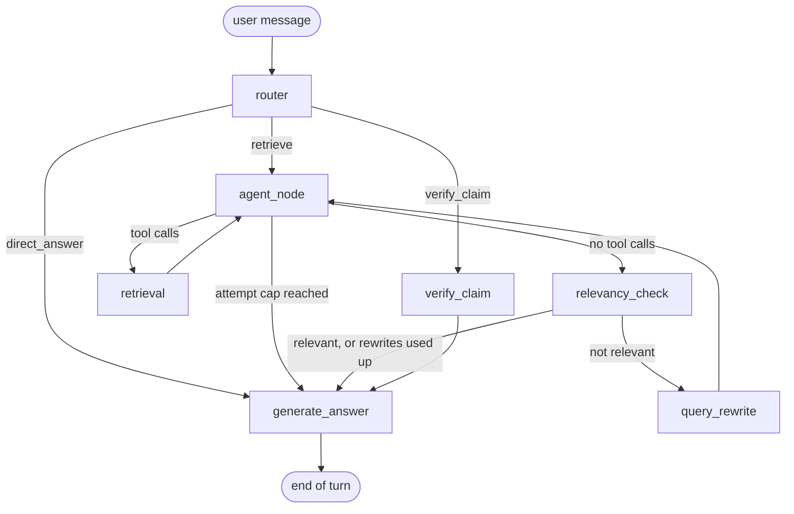
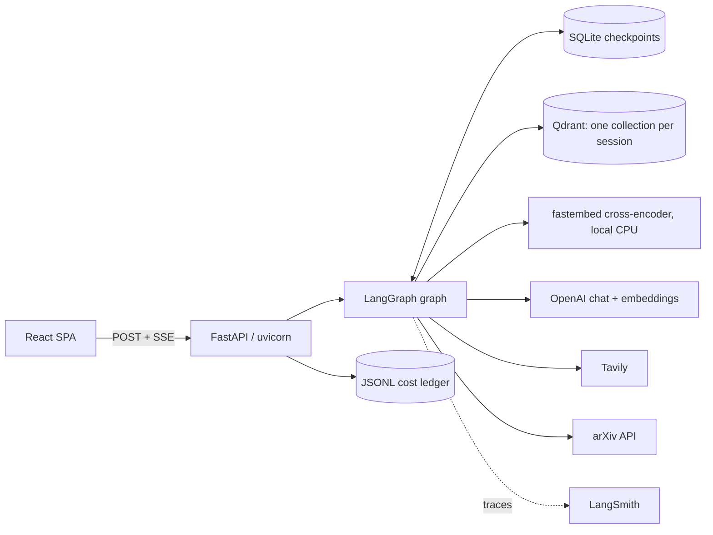

# Papeer

Papeer is a chat app for asking questions about research papers. Each chat session has its own
document collection: you add PDFs, text or Markdown files, web pages or arXiv papers, and answers are
generated from chunks retrieved from that collection. Papeer can also check whether a claim
(for example "BERT is state of the art on GLUE") has been superseded or challenged. It searches the arXiv API and
Tavily web search, and it keeps a citation only if that citation matches a retrieved evidence item.

**Stack:** LangGraph, LangChain, OpenAI (`gpt-6-luna` chat, `text-embedding-3-small` embeddings),
Qdrant (hybrid dense + BM25), fastembed ONNX cross-encoder, FastAPI with Server-Sent Events,
React 19 + Vite + TypeScript + Tailwind v4 + shadcn/ui, SQLite checkpoints, LangSmith tracing, DeepEval.

Earlier versions used Streamlit. The current UI is the React SPA in `frontend/`.

---

## Features

| Feature | What it does |
|---|---|
| Paper Q&A | A tool-calling agent retrieves chunks from the session's Qdrant collection. The answer is generated only from those chunks, and the model is told to say so when they do not contain the answer. |
| Claim verification | One structured LLM call plans the queries. arXiv and Tavily are then searched concurrently, and the verdict is one of `superseded`, `challenged`, `still_holds` or `insufficient_evidence`. Citations are checked against the evidence list (see below). |
| Web search | The retrieval agent also has a `web_search` (Tavily) tool for current information. |
| Direct answers | The router sends questions about stable general knowledge straight to the answer step, with no retrieval. |
| `/btw` side channel | Off-topic questions go to a separate endpoint (`POST /api/btw`). An LLM decides whether to answer directly or search the web. These exchanges are not stored in session history. |
| Sessions | Each session is a LangGraph checkpoint thread (SQLite), so history survives restarts. Session metadata lives in `sessions.json`, and the session title is generated from the first message. Deleting a session also deletes its Qdrant collection and checkpoint thread. |
| Sources | PDF/TXT/MD upload (multipart), web URLs, arXiv ID or title. Re-uploading a duplicate is skipped. |
| Streaming | Answers stream token by token over SSE. Progress labels ("Routing question", "Searching papers", "Checking relevance", "Searching arXiv and the web", "Writing answer", ...) are sent as each graph node starts. A Stop button cancels the request. |
| Per-turn stats | Each answer shows latency, input/output tokens and estimated cost. |
| Graph-state inspector | A drawer shows the final LangGraph state for each turn (route, retrieved chunks, rewrite count, claim-check details). |

---

## Architecture

### LangGraph workflow (`backend/rag_graph.py`)



[`graph.png`](graph.png) is LangGraph's own rendering of the same compiled graph.

- **router**: an LLM with structured output (`retrieve | verify_claim | direct_answer`). It sees
  the current message plus a short view of the last two visible turns, so follow-up questions resolve correctly. When it is
  unsure, it is prompted to prefer `retrieve`.
- **agent_node / retrieval**: a tool-calling LLM (`parallel_tool_calls=False`) picks
  `retrieve_from_vectorstore` (with `k` from 1 to 10) or `web_search`. `retrieval` is a LangGraph `ToolNode`. Chunks
  accumulate across calls and are de-duplicated. The agent sees only the last `MAX_HISTORY_TURNS`
  (default 3) user turns, and the checkpoint keeps the full history.
- **relevancy_check**: a lenient binary LLM grade of the first 3 chunks (first 300 characters of each).
  If the grade is "not relevant" and rewrites remain, **query_rewrite** rewrites the query and starts a new cycle.
  The grade decides whether to rewrite, not whether to answer.
- **generate_answer**: a separate model instance with no tools bound and its own
  `ANSWER_REASONING_EFFORT`. Chunks are wrapped in `<context><chunk ...>` tags, and the system prompt treats
  them as untrusted data.
- **verify_claim** (`backend/claim_verification.py`) runs five steps:
  1. **plan**: one structured call produces an arXiv query and a web query. If the call fails, a keyword query is used instead.
  2. **gather**: arXiv (`arxiv` package, 3 s between requests, 10 s timeout) and Tavily run in parallel under one 25 s
     deadline. Each source records ok / empty / failed instead of raising. If both return nothing, the
     result is "could not verify" and the verdict LLM is never called.
  3. **evidence**: results are de-duplicated by URL and numbered E1..En. Snippets are sanitised so they cannot close the
     evidence tags or forge evidence ids.
  4. **verdict**: a structured LLM call that may cite only evidence ids.
  5. **validate**: a cited paper is kept only if its evidence id exists. Title, URL and date are copied from the
     evidence, not from the LLM. arXiv papers older than the claim's date are dropped, and URLs that are not in the evidence are
     scrubbed. At most 3 papers are kept, newest first. A `superseded` or `challenged` verdict with no surviving paper is
     downgraded to `insufficient_evidence`.

### System



- The chat endpoint runs `graph.astream(stream_mode=["messages", "tasks"])` and sends SSE frames
  `data: {json}` with the types `status`, `token`, `done` and `error`. A `: ping` heartbeat is sent after 15 s of silence, and
  each request has a 180 s overall timeout. Error frames carry a generic message and a code (`timeout | loop_limit | internal`),
  and the real error is logged on the server.
- The frontend uses `@microsoft/fetch-event-source` because native `EventSource` cannot POST a JSON body.
  Auto-retry is off, so switching tabs does not re-run the graph.
- In Docker, one image serves the built SPA and the API on port 8000.
- LangSmith traces include per-node spans plus custom spans for Qdrant, reranking, Tavily and arXiv. These custom spans log only
  lengths, counts and hashes, not content. `observability/runs.jsonl` is a local ledger with no secrets, recording latency, route,
  token counts and estimated cost for each run.

---

## How retrieval works

Code: `backend/vector_store.py`, `backend/reranker.py`, `backend/paper_loader.py`.

1. **Chunking.** `RecursiveCharacterTextSplitter` with `chunk_size=1000` characters, `chunk_overlap=200` and
   `add_start_index=True`. Markdown files use the Markdown splitter. PDFs are parsed with PyMuPDF (max 500 pages,
   max 2000 chunks per document).
2. **Dense vectors.** `text-embedding-3-small` (1536 dimensions), cosine distance.
3. **Sparse vectors.** fastembed `Qdrant/bm25`, stored in Qdrant as a named sparse vector
   (`langchain-sparse`) with `Modifier.IDF`, so Qdrant computes IDF on the server.
4. **Fusion.** `RetrievalMode.HYBRID` sends one Query API request with a dense prefetch and a sparse prefetch, and
   Qdrant fuses them with Reciprocal Rank Fusion.
5. **Rerank.** Stage 1 returns `max(RETRIEVAL_CANDIDATE_K, k)` candidates (default 20). Stage 2 scores each
   (query, chunk) pair with the local cross-encoder `Xenova/ms-marco-MiniLM-L-6-v2` (fastembed `TextCrossEncoder`, ONNX on CPU)
   and keeps the agent's `k` (default `RERANK_TOP_N=4`).
6. **Embedding cache.** LangChain `CacheBackedEmbeddings` over a `LocalFileStore` (`embedding_cache/`). The cache key
   is the embedding model name (used as a namespace) followed by the `blake2b` hash of the text, so changing the model cannot return stale vectors.
   Query embeddings are cached too. The cache is append-only, local to one machine, and has no TTL or eviction.

`RETRIEVAL_MODE=dense|hybrid` and `RERANK_ENABLED=true|false` switch between the dense-only baseline and
hybrid + rerank. The defaults are hybrid with rerank.

---

## Loop bounds

Two counters bound each turn:

- `A = MAX_RETRIEVAL_ATTEMPTS` (default 3, allowed range 1–5): tool rounds per retrieval cycle. When the agent reaches the cap, it is called
  without tools, so it cannot request another retrieval.
- `R = MAX_QUERY_REWRITES` (default 1, allowed range 0–3): rewrite cycles per turn. `query_rewrite` resets the attempt counter.

The worst-case formulas are in `rag_graph.py`:

| Quantity | Formula | Defaults (A=3, R=1) | Env maxima (A=5, R=3) |
|---|---|---|---|
| LangGraph supersteps | `(R+1)(2A+1) + 3` | 17 | 47 |
| Chat-model calls (retrieve route) | `R(A+2) + A + 3` | 11 | 29 |
| `recursion_limit` (worst + 4) | baked in by `compile_graph()` via `with_config` | 21 | 51 |

`direct_answer` makes 2 chat-model calls (router + answer). `verify_claim` makes 3: the router plus the verifier's
plan and verdict calls (its answer is a template). LangGraph's default
`recursion_limit` of 25 would abort legitimate turns at the env maxima. If `GRAPH_RECURSION_LIMIT` is set below the worst
case, it is raised to the worst case and a warning is logged. Every LLM call has a 60 s timeout, `max_retries=2` and `max_tokens=2048`.

`tests/test_graph_bounds.py` checks these bounds. A scripted adversary drives the graph to exactly the worst case, a
`recursion_limit` one lower raises `GraphRecursionError`, an agent that always calls tools still terminates, and the rewrite
loop stays bounded when the agent never retrieves.

---

## Quick start

### Prerequisites

- Python 3.12+ and [uv](https://github.com/astral-sh/uv)
- Node.js 22 (for the frontend)
- API keys for OpenAI and Tavily, plus a Qdrant instance (Qdrant Cloud or local)
- Docker (optional)

### Install

```bash
uv sync                           # runtime + dev + eval dependency groups
# or, runtime only:
pip install -r requirements.txt
cp .env.example .env              # then fill in the values
```

### Environment variables

`.env.example` lists all variables with comments. Grouped by purpose:

- **Required:** `OPENAI_API_KEY`, `TAVILY_API_KEY`, `QDRANT_URL`, `QDRANT_API_KEY`
- **Optional, LangSmith tracing:** `LANGSMITH_TRACING`, `LANGSMITH_API_KEY`, `LANGSMITH_PROJECT`,
  `LANGSMITH_ENDPOINT`, `LANGSMITH_WORKSPACE_ID`
- **Models and retrieval:** `OPENAI_CHAT_MODEL`, `OPENAI_RENAME_MODEL`, `OPENAI_EVAL_MODEL`,
  `OPENAI_EMBEDDING_MODEL`, `OPENAI_EMBEDDING_DIM`, `TAVILY_SEARCH_DEPTH`, `TAVILY_MAX_RESULTS`,
  `MAX_RETRIEVAL_ATTEMPTS`, `MAX_QUERY_REWRITES`
- **API, auth and limits:** `AUTH_MODE`, `PAPEER_ACCESS_CODE`, `CORS_ORIGINS`, `STATIC_DIR`,
  `DAILY_BUDGET_USD`, `RATE_LIMIT_WINDOW_SECONDS`, `RATE_LIMIT_CHAT`, `RATE_LIMIT_BTW`,
  `RATE_LIMIT_DOCUMENTS`, `RATE_LIMIT_SESSIONS`, `HEARTBEAT_SECONDS`, `REQUEST_TIMEOUT_SECONDS`,
  `MAX_MESSAGE_CHARS`, `MAX_BTW_QUERY_CHARS`, `MAX_UPLOAD_MB`, `MAX_FILES_PER_REQUEST`,
  `MAX_URLS_PER_REQUEST`, `MAX_CHUNKS_PER_DOCUMENT`, `MAX_PDF_PAGES`
- **Local state:** `EMBEDDING_CACHE_DIR`, `CHECKPOINT_DB_PATH`, `SESSIONS_FILE`, `METRICS_DIR`,
  `LOCAL_METRICS_ENABLED`, `LOG_LEVEL`

To run Qdrant locally instead of on Qdrant Cloud:

```bash
docker run -p 6333:6333 qdrant/qdrant:v1.17.1
# .env: QDRANT_URL=http://localhost:6333 and QDRANT_API_KEY= (empty)
```

### Run (development)

```bash
uv run uvicorn api.main:app --port 8000          # backend; AUTH_MODE defaults to none here
cd frontend && npm ci && npm run dev             # http://localhost:5173, Vite proxies /api to :8000
```

### Run (Docker)

```bash
# set PAPEER_ACCESS_CODE in .env (8+ characters)
docker compose up --build
# open http://localhost:8000 and enter the access code
```

Under compose, `AUTH_MODE` defaults to `api_key`. Sessions, checkpoints, the embedding cache and the ledger are
stored in the named volume `papeer-data`.

### Tests

```bash
uv run python -m pytest -q
```

All tests run offline, with fakes and mocks in place of OpenAI, Tavily, Qdrant and arXiv.

---

## Evaluation

`evaluate.py` is a DeepEval harness, and `eval_router.py` measures router accuracy on `evals/router_cases.json`.

- **Metrics:** Faithfulness, Answer Relevancy, Contextual Precision, Contextual Recall and Contextual Relevancy,
  each with a threshold of 0.7. `--metrics` selects a subset.
- **Models:** the app and the judge are both `gpt-6-luna`. The judge runs with `reasoning_effort=low` and is registered
  in DeepEval with its prices, so judge cost cannot silently be reported as $0.
- **Data:** a single 34-page PDF (`documents/Openclaw_Research_Report.pdf`). `goldens.json` holds 10 synthetic cases
  (DeepEval Synthesizer, LLM-written). `goldens_curated.json` holds 7 hand-written cases: factual, two numeric,
  multi-section, security, unanswerable and timeline.
- **Isolation:** by default the agent runs paper-only (`paper_only=True`), so it cannot use web search, and each case gets a fresh Qdrant
  collection. Results are matched to cases by input text.
- **Statistics:** bootstrap 95% confidence intervals over case scores. With `--runs 1` these do not capture run-to-run or
  judge variance. `--runs N` repeats the full pass.
- **Cost control:** `--dry-run` prints the plan and a cost estimate without any API call or Qdrant connection. `--budget-usd` stops the
  run before any case that would exceed the cap.

To reproduce all reported numbers with one command:

```bash
uv run python scripts/reproduce_eval.py --dry-run          # plan + estimate, no API calls
uv run python scripts/reproduce_eval.py --budget-usd 2.00  # router eval + RAG eval
```

The command writes `results/SUMMARY.md` (plus a timestamped copy) and one JSON report per step in `results/`.

**What Faithfulness measures:** the share of answer claims that the retrieved context does not contradict.
Claims the context neither supports nor contradicts count as faithful. Faithfulness does **not** measure correctness against the
expected answer, retrieval quality, or completeness. Since the app and the judge are the same model, scores may be
inflated by self-preference bias.

### Current results (21 Oct 2026, commit `0e654d2`, `python scripts/reproduce_eval.py --budget-usd 1.00`, $0.16)

Full report: [`results/SUMMARY.md`](results/SUMMARY.md).

| Metric | Mean | 95% CI | n |
|---|---:|---|---|
| Router accuracy | 1.000 | — | 30 cases × 3 runs |
| Faithfulness | 0.992 | [0.975, 1.0] | 17 × 3 |
| Answer Relevancy | 0.999 | [0.996, 1.0] | 17 × 3 |
| Contextual Precision | 0.964 | [0.93, 0.99] | 17 × 1 |
| Contextual Recall | 0.937 | [0.87, 0.99] | 17 × 1 |
| Contextual Relevancy | 0.533 | [0.41, 0.65] | 17 × 1 |

How to read these:
- **Faithfulness is close to the ceiling.** Two earlier 3-run evaluations of the same configuration gave 1.000 and 0.998, so run-to-run variance is about ±0.01, and this set barely separates configurations.
- **The misses are real.** On `synthetic:4`, the answer repeats the question's own unsupported wording ("API-key sprawl", "vibe-coded"). On `synthetic:7`, it calls an existing audit-logging measure a future feature. Leading synthetic questions are one reason a larger, hand-written set is the next step.
- **The unanswerable question is answered correctly in every run** (it says the context does not contain the answer), but it scores 0 on the contextual metrics by construction.
- **Contextual Relevancy is low** because 1000-character chunks include many sentences unrelated to the question.
- **Router accuracy** comes from a small hand-labelled set and is a smoke test, not a benchmark.
- **A/B on reasoning in the answer step** (`none` vs `low`, judged by the same fixed judge): no measurable difference (paired ΔFaithfulness −0.006, 95% CI [−0.021, +0.004]), so the default stays `none` (`results/ab_answer_reasoning.md`).

**Earlier results.** The August 2026 runs used `gpt-5-mini` and the original dense-only pipeline, including the 0.981 Faithfulness run on
the 10 synthetic goldens. They are archived in `results/archive/2026-08_gpt-5-mini/` with their provenance and a
correction note. The current code cannot regenerate them, and they are not comparable with current runs.

---

## Security and limits

Implemented in `api/deps.py`, `api/ratelimit.py`, `api/settings.py` and `backend/paper_loader.py`:

- **Auth modes** (`AUTH_MODE`):
  - `none`: local development only.
  - `api_key`: a shared `PAPEER_ACCESS_CODE` of at least 8 characters, sent as a Bearer token and compared in constant time.
  - `easyauth`: reads Azure's `X-MS-CLIENT-PRINCIPAL` header. This is only safe when all ingress goes through Easy Auth.
- **Ownership:** each session records its owner. A session id that belongs to someone else, or is malformed, returns 404.
- **Rate limits:** sliding window per principal. Defaults per minute: chat 10, `/btw` 10, documents 10, sessions 30.
- **Daily budget:** `DAILY_BUDGET_USD` (default $1.00) is checked against the ledger's estimated spend for the UTC day.
  Once it is exceeded, requests get `429` before any model call. The estimate does not include Tavily cost. The real hard cap is the budget on the OpenAI project.
- **Input limits:** message ≤ 4000 characters, `/btw` ≤ 2000, ≤ 5 files of ≤ 20 MB each (the cap is enforced while streaming the upload),
  PDF magic-byte check, ≤ 5 URLs per request.
- **SSRF guard for URL ingestion:** http/https only. Every resolved IP is checked and rejected if it is private, loopback,
  link-local (including `169.254.169.254`), multicast, reserved or mapped. At most 3 redirects are followed, each re-validated, with a 5 MB size cap and a timeout.
- **Untrusted content:** retrieved chunks and claim evidence are wrapped in tags and labelled as untrusted data in the
  prompt, and tag break-outs are neutralised. The Markdown renderer never loads images, which blocks exfiltration through image URLs.
  Links open with `rel="noopener noreferrer nofollow"`.
- **Secrets:** `.env` is git-ignored and the image contains no secrets. CORS uses an env allowlist without credentials.

### Known limitations

- Rate limits, the daily budget and the arXiv rate limiter are kept in memory per process and reset on restart.
- The design assumes a single process. SQLite checkpoints and `sessions.json` support one writer, so running several replicas
  would need a shared store such as Postgres for checkpoints.
- In `api_key` mode, everyone shares one principal and therefore one session list.
- The retrieval tool returns only "Retrieved N chunk(s)" to the agent, not the chunk text. As a result, how many tool calls the agent
  makes per turn varies (usually 1, sometimes the cap of 3), and latency varies with it.
- No current measurement shows that hybrid + rerank beats dense-only retrieval. The August A/B used n=5 single
  runs and was within noise.
- Claim verification checks citations programmatically, but whether a paper actually supersedes a claim is still
  an LLM judgement. There is no citation-graph analysis, web results carry no dates, and the claim-date heuristic can misread
  numbers. Prompt injection through evidence can still bias the verdict text but cannot add links.
- If the client disconnects, the run is cancelled, but an OpenAI call that is already in flight still completes. The user's question remains in the
  checkpoint without an answer.
- Untrusted PDFs are parsed in-process by PyMuPDF.
- There is no CI/CD pipeline, and the app is not deployed publicly.

---

## Deployment

`docker compose up --build` runs the whole app as one container on a single machine. [docs/DEPLOYMENT.md](docs/DEPLOYMENT.md)
covers local development, Compose, and the recommended cloud path: Azure Container Apps on the consumption plan with
min 0 / max 1 replica, secrets as Container Apps secrets, Easy Auth or the access code, and an OpenAI project
budget plus `DAILY_BUDGET_USD`. The guide also explains why SQLite must not sit on an SMB (Azure Files) share, and it describes a
simpler non-Azure alternative. The app has not been deployed with this guide yet.

---

## Project layout

| Path | Contents |
|---|---|
| `api/` | FastAPI app: `main.py` (app factory, CORS, SPA mount), `chat.py` (SSE chat and `/btw`), `streaming.py` (SSE pump, heartbeat, timeout), `deps.py` (auth, ownership, rate limit, budget), `sessions.py`, `documents.py`, `session_store.py`, `ratelimit.py`, `settings.py` |
| `backend/rag_graph.py` | LangGraph state, nodes, routing, bound formulas, answer prompt |
| `backend/claim_verification.py` | Claim verifier: plan, arXiv + Tavily search, evidence, verdict, validation |
| `backend/arxiv_client.py` | Rate-limited arXiv API client with a timeout |
| `backend/vector_store.py` | Qdrant collections, hybrid retrieval, two-stage `retrieve()`, embedding cache |
| `backend/reranker.py` | fastembed ONNX cross-encoder |
| `backend/paper_loader.py` | PDF/TXT/MD/URL/arXiv loaders, SSRF guard, chunking |
| `backend/llm.py`, `backend/config.py` | Chat-model factory, env-driven settings and pricing table |
| `backend/btw_handler.py` | `/btw` side channel |
| `backend/history.py`, `backend/telemetry.py`, `backend/tracing.py` | Visible chat history, JSONL cost ledger, LangSmith spans |
| `frontend/` | React SPA (see `frontend/README.md`) |
| `tests/` | Offline pytest suite |
| `evaluate.py`, `eval_router.py`, `scripts/reproduce_eval.py` | DeepEval harness, router eval, one-command reproduction |
| `goldens.json`, `goldens_curated.json`, `evals/` | Evaluation cases |
| `documents/` | The PDF used for evaluation |
| `results/` | Evaluation reports, `SUMMARY.md`, `archive/` |
| `docs/DEPLOYMENT.md` | Deployment guide |
| `Dockerfile`, `docker-compose.yml` | Multi-stage image (SPA + API on :8000), single-container compose |
| `pyproject.toml`, `uv.lock`, `requirements.txt` | Dependencies (`requirements.txt` is runtime-only, exported from `uv.lock`) |
